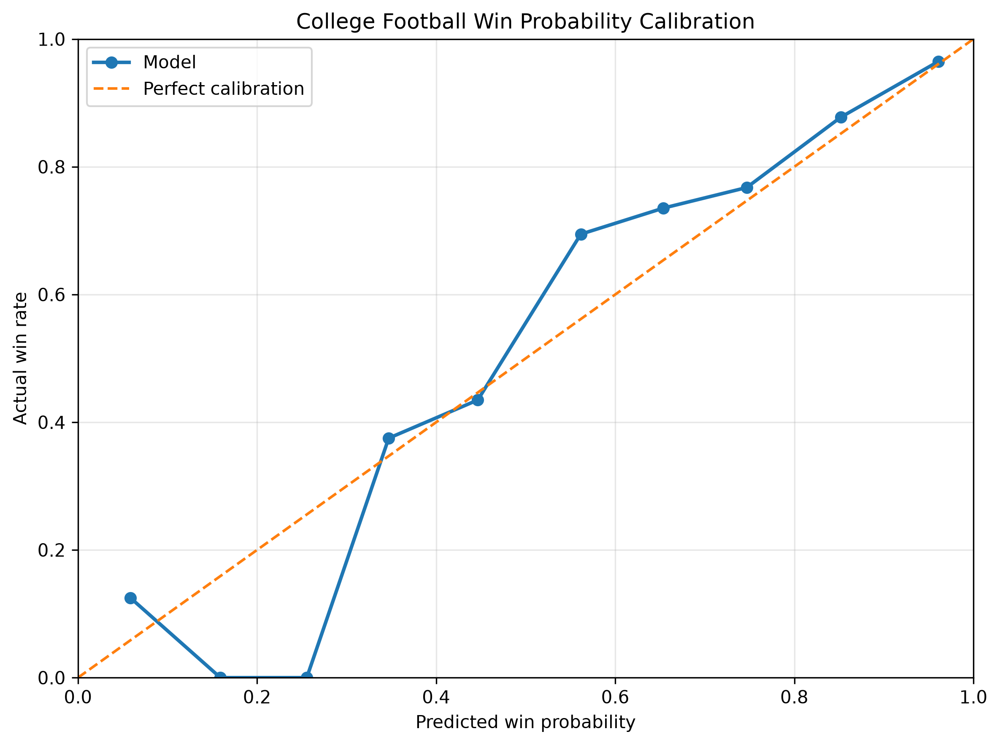
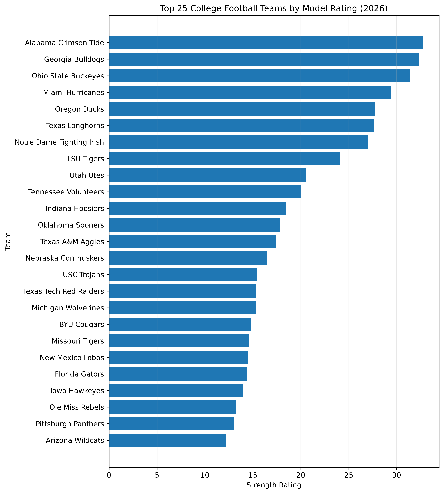
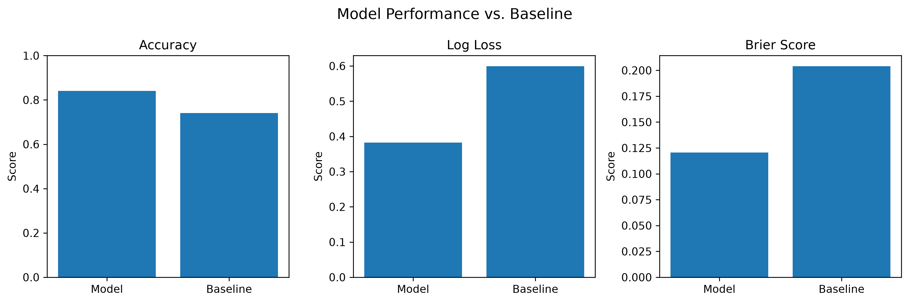

# College Football Win Probability Model

A Python-based college football modeling project that estimates team strength and game win probabilities using historical performance, team talent, recruiting, returning production, and home-field advantage.

The project is designed to update as new game results become available, allowing current-season team ratings and hypothetical matchup probabilities to be generated from the most recent data.

## Project Overview

The model uses historical college football data to:

* Build dynamic team strength ratings
* Incorporate team performance and roster-related information
* Estimate the probability that one team defeats another
* Evaluate predictions on an out-of-sample season
* Analyze probability calibration
* Produce current-season team rankings
* Generate hypothetical matchup probabilities

The project uses a rolling approach to team ratings so that information from games that occurred later in a season is not used to predict earlier games.

## Data

The project uses publicly available college football data from SportsDataverse.

The data includes information such as:

* Game schedules and results
* Team talent
* Recruiting
* Returning production
* Team performance statistics

Historical seasons are used to develop the model, while the current season is used for out-of-sample evaluation and current team ratings.

## Model Features

The model incorporates information including:

* Previous-season win percentage
* Previous-season average point differential
* Team talent
* Recruiting information
* Returning production
* Home-field advantage
* Dynamic team strength ratings

Team strength is updated as new game results become available.

## Modeling Approach

The project uses a logistic regression model to estimate game win probabilities.

For a hypothetical matchup, the model considers the difference between the two teams' current strength ratings along with home-field advantage.

The logistic regression model converts these inputs into a probability between 0 and 1.

For example:

```text
Team A rating - Team B rating
              +
      Home-field advantage
              ↓
      Logistic regression
              ↓
      Team A win probability
```

The model is evaluated using data from the 2026 season that was not used to fit the probability model.

## Model Evaluation

The 2026 season is used as an out-of-sample test set, while previous seasons are used to train the probability model.

The model is compared against a baseline that uses the historical home-team win rate.

### Results

| Metric      | Model | Baseline |
| ----------- | ----: | -------: |
| Accuracy    | 84.0% |    74.1% |
| Log Loss    | 0.382 |    0.600 |
| Brier Score | 0.121 |    0.204 |

The model improved accuracy by approximately 10 percentage points compared with the baseline.

The lower log loss and Brier score also indicate that the model's predicted probabilities provide more useful probabilistic predictions than the baseline.

## Calibration

The model's probability calibration is evaluated by comparing predicted win probabilities with the actual win rate of games falling within each probability range.



A perfectly calibrated model would follow the diagonal reference line.

Calibration is expected to become more informative as additional games are added to the current-season dataset.

## Current Team Rankings

The model produces current-season team strength ratings that can be used to rank teams.



These rankings are based on the model's current strength ratings and update as new game results become available.

## Model Performance

The project also compares the model's performance against the baseline using accuracy, log loss, and Brier score.



## Command-Line Usage

After installing the required packages, the model can be run from the project directory.

### Update the model

```bash
python main.py update
```

### Display the current Top 25

```bash
python main.py top25
```

### View information about a team

```bash
python main.py info Alabama
```

### Check a team's most recent completed game

```bash
python main.py check Alabama
```

### Predict a hypothetical matchup

```bash
python main.py game Alabama Georgia
```

The matchup command returns the model's current win probability for each team.

### Evaluate the model

```bash
python main.py evaluate
```

### Generate the calibration analysis

```bash
python main.py calibration
```

## Installation

Clone the repository and navigate to the project directory.

Create and activate a virtual environment if desired, then install the required packages:

```bash
pip install -r requirements.txt
```

The project requires:

* Python
* pandas
* NumPy
* scikit-learn
* Matplotlib
* PyArrow
* requests
* certifi

## Project Structure

```text
College-Football-Win-Probability/
│
├── data/
│   └── raw/
│
├── notebooks/
│   └── 01_exploring_data.ipynb
│
├── outputs/
│   └── figures/
│       ├── calibration.png
│       ├── model_performance.png
│       └── top25_ratings.png
│
├── src/
│   └── cfb_model.py
│
├── main.py
├── README.md
└── requirements.txt
```

## Future Updates

The model is designed to be updated as additional game results become available.

Potential future improvements include:

* Additional predictive features
* More detailed team and player statistics
* Alternative machine-learning models
* Improved probability calibration
* More extensive historical validation
* Additional visualization and analysis

## Disclaimer

This project is intended as a modeling and data-analysis project. The probabilities represent model estimates and should not be interpreted as guarantees of game outcomes.
